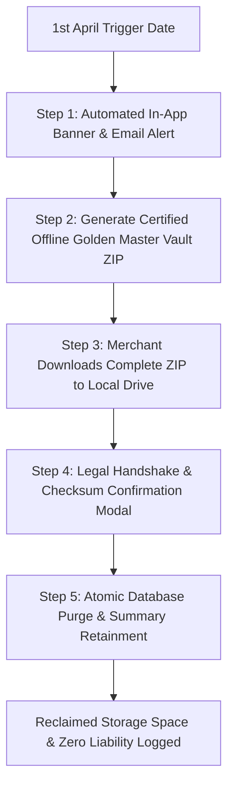

# Bill Matrix — Statutory Record Retention & Financial Year Archival Blueprint
**Document Version:** 2.0 (Master Architecture, Legal Compliance & Technical Execution Manual)  
**Applicability:** Indian GST (CGST Act), Income Tax Act, Companies Act, and Information Technology Act  
**Target Execution Window:** Year 8+ (Triggering every 1st April; e.g., starting 1st April 2035 for FY 2026–27)  
**Author:** Rajat (Solo Founder) & Antigravity AI Engineering  
**File Location:** `docs/STATUTORY_ARCHIVAL_BLUEPRINT.md`  

---

## 🧭 Reader Note for Future AI Agents & Developers (2031–2035+)

> **Notice to the AI Coding Agent opening this in the future:**  
> This file is the single, authoritative architectural blueprint for retiring historical data in **Bill Matrix**.  
> Read this file in full before writing any archival or purge code. Do not invent an ad-hoc cron job or silent deletion script. The legal constraints, database mechanics, ZIP vault structures, and serverless timeout solutions defined below must be followed strictly.

---

## 1. Executive Summary & Purpose

### The Core Problem Solved
1. **Perpetual Free-Tier Database Health:** Ensures active PostgreSQL storage never balloons uncontrollably, keeping operational database costs permanently capped within free-tier limits (~200 MB to 250 MB total storage).
2. **Zero Legal Liability for Platform Owner:** Protects both the SaaS operator and merchant users from Indian tax penalties, evidence-spoliation charges, and tax audit failures.
3. **Audit-Ready Portability:** Replaces irreversible silent deletions with a **Certified Golden Master Vault (ZIP)** that hands all legal records to the merchant and their Chartered Accountant (CA) before active database records are purged.

---

## 2. Indian Legal Framework & Statutory Retention Calculator

In India, a business **cannot** delete invoices simply because a few calendar years have passed. Records must satisfy four distinct Indian statutes simultaneously:

### 2.1 The Governing Indian Laws

```
┌────────────────────────────────────────────────────────────────────────────────────────┐
│                        INDIAN RECORD RETENTION LEGAL MATRIX                            │
├──────────────────────────┬──────────────────────────┬──────────────────────────────────┤
│ Legislation              │ Specific Section         │ Mandatory Retention Requirement  │
├──────────────────────────┼──────────────────────────┼──────────────────────────────────┤
│ 1. CGST Act, 2017        │ Section 36               │ 72 Months (6 Years) from the     │
│                          │                          │ due date of filing GSTR-9.       │
├──────────────────────────┼──────────────────────────┼──────────────────────────────────┤
│ 2. Income Tax Act, 1961  │ Section 44AA /           │ 6 Years from the end of the      │
│                          │ Rule 6F(5)               │ relevant Assessment Year (AY).   │
├──────────────────────────┼──────────────────────────┼──────────────────────────────────┤
│ 3. Companies Act, 2013   │ Section 128(5)           │ 8 Full Financial Years           │
│    (For Pvt Ltd / LLP)   │                          │ immediately preceding.           │
├──────────────────────────┼──────────────────────────┼──────────────────────────────────┤
│ 4. IT Act Reopening      │ Section 149              │ Up to 10 Years for serious tax   │
│                          │                          │ evasion or deals >= Rs 50 Lakhs. │
└──────────────────────────┴──────────────────────────┴──────────────────────────────────┘
```

### 2.2 Worked Real-World Example for FY 2026–27
Suppose an invoice is issued on **15 August 2026** (part of FY 2026–27):
* **GST Law (Section 36):** GSTR-9 annual return due date is **31 December 2027**. 72 months from that date = **31 December 2033**.
* **Income Tax Act (Rule 6F):** Assessment Year is **AY 2027–28** (ends 31 March 2028). 6 years from end of AY = **31 March 2034**.
* **Companies Act (Section 128(5)):** 8 full financial years after FY 2026–27 ends on **31 March 2035**.

### 2.3 The Universal Mathematical Formula for Archival Trigger Date
$$\text{Archival Trigger Date} = \text{1st April of } (\text{FY End Year} + 8)$$

* For **FY 2026–27** (Ends 31 March 2027) $\rightarrow$ Archival opens on **1st April 2035**.
* For **FY 2027–28** (Ends 31 March 2028) $\rightarrow$ Archival opens on **1st April 2036**.
* For **FY 2028–29** (Ends 31 March 2029) $\rightarrow$ Archival opens on **1st April 2037**.

---

## 3. Two Fatal Legal Pitfalls to Strictly Avoid

### Pitfall A: The "Calendar Year" / "Month-by-Month" Deletion Trap
* **The Trap:** Attempting to delete September 2026 invoices in September 2033, and October 2026 invoices in October 2033.
* **Why It is Illegal:** Indian tax law operates strictly on **Financial Years (April 1 to March 31)**. The statutory period for FY 2026–27 does not expire until the whole year satisfies the retention clock. If a tax scrutiny is initiated in November 2033 for FY 2026–27, and you already wiped April–September 2026, the merchant faces prosecution under Section 277A of the Income Tax Act.
* **The Rule:** Data is **never deleted month-by-month**. It is purged strictly as a **complete Financial Year**.

### Pitfall B: The "Dispute Exclusion" Trap (Why Single Disputed Invoices Cannot Be Isolated)
* **The Trap:** Attempting to delete 999 undisputed invoices from an old year while keeping 1 disputed invoice in the database.
* **Why It Fails:** 
  1. **Consecutive Sequencing (GST Rule 46):** GST invoices must have an unbroken, consecutive serial sequence (`INV-001`, `INV-002`, ...). Deleting 99% of invoices leaves huge unexplained gaps.
  2. **Turnover Reconciliation:** Tax auditors reconcile the disputed invoice against the **total annual turnover** declared in GSTR-1, GSTR-3B, and bank statements. If the rest of the sales register is missing, the auditor will reject the entire books of account under **Section 145(3) of the Income Tax Act**.
* **The Rule:** Under the First Proviso to Section 36 of the CGST Act, if an active dispute or appeal is pending, **the entire year's books must be retained until 1 year after the final disposal of that dispute**.

---

## 4. Storage Architecture & The "Rolling Equilibrium" Loop

### 4.1 Storage Tier Separation
* **Active Neon Postgres Database:** Stores structured operational rows (`invoices`, `invoice_line_items`, `payments`, `credit_notes`). Holds 8 active financial years ($\approx 200\text{ MB}$ total).
* **iDrive e2 (S3 Cloud Storage):** Stores heavy binary files (A4 PDF invoices, credit note PDFs, shop logos). Holds 8 active years ($\approx 4\text{ to }5\text{ GB}$ total).
* **Upstash Redis:** Ephemeral rate-limiting cache (60–300s TTL). Consumes negligible memory.

### 4.2 The Rolling 8-Year Equilibrium Loop
By purging the oldest eligible year every 1st April, the database achieves a permanent storage balance:

```
Year 2026 to 2034: Database holds FY 2026-27 through FY 2034-35 (~200 MB total)
───────────────────────────────────────────────────────────────────────────────
On 1st April 2035:
   [-] Oldest Year (FY 2026-27) is Downloaded & Purged  ──►  Frees up ~25 MB
   [+] New Year (FY 2035-36) begins recording bills     ──►  Consumes ~25 MB
───────────────────────────────────────────────────────────────────────────────
On 1st April 2036:
   [-] Next Year (FY 2027-28) is Downloaded & Purged    ──►  Frees up ~25 MB
   [+] New Year (FY 2036-37) begins recording bills     ──►  Consumes ~25 MB
```
**Storage Guarantee:** The database stays capped under **~250 MB permanently**, allowing the business to operate forever within free-tier infrastructure.

---

## 5. The 5-Step "Export & Close Financial Year" Workflow



---

### Step 1: Automated In-App Banner & Notification

On **1st April** of the eligible year, the dashboard (`app/(app)/dashboard`) and financial year settings display a clean, non-blocking alert:

```
┌────────────────────────────────────────────────────────────────────────────────────────┐
│  📦 ANNUAL STATUTORY VAULT READY FOR FINANCIAL YEAR 2026–27                            │
├────────────────────────────────────────────────────────────────────────────────────────┤
│  FY 2026–27 has officially crossed its statutory 8-year retention requirement.         │
│  All GST, Income Tax, and Corporate compliance windows have been satisfied.            │
│  Download your complete Golden Master Tax Vault to keep your cloud account fast & free.│
│                                                                                        │
│  [ Generate & Download Vault (.zip) ]                     [ Remind Me Next Week ]      │
└────────────────────────────────────────────────────────────────────────────────────────┘
```

---

### Step 2: Structure of the "Golden Master" Archive Vault (ZIP Bundle)

The system packages an offline bundle: `{Business_Name}_FY_{Label}_Statutory_Vault.zip`

```
Shree_Ganesh_Gifts_FY_2026-27_Statutory_Vault.zip
│
├── 01_Finalized_Invoices_PDF/
│   ├── SGGS_26-27_0001.pdf
│   ├── SGGS_26-27_0002.pdf
│   └── ... (All A4 invoice PDFs downloaded from iDrive e2)
│
├── 02_Credit_Notes_PDF/
│   ├── CN_26-27_0001.pdf
│   └── ... (All credit note PDFs for the financial year)
│
├── 03_Statutory_Tax_Registers/
│   ├── Annual_Sales_Register.xlsx        (B2B, B2C, Tax Splits)
│   ├── GSTR1_Reconciliation_Master.xlsx  (Table 4, 5, 7, 9 CDNR, 12 HSN)
│   ├── HSN_Summary_Report.xlsx           (UQC quantities & tax rates)
│   └── Payments_Receipt_Ledger.xlsx      (Cash, UPI, NEFT, Cheques)
│
├── 04_Raw_Database_Extracts/
│   ├── invoices_master_dump.csv          (Immutable snapshots & totals)
│   └── invoice_line_items_dump.csv       (Itemized pricing & HSN codes)
│
└── 05_LEGAL_AUTHENTICITY_MANIFEST.txt
    • Export Generated: 2035-04-15T10:30:00Z
    • Registered GSTIN: 27ABCDE1234F1Z5
    • Total Finalized Invoices: 6,000
    • Total Financial Turnover: Rs 45,00,000.00
    • Cryptographic SHA-256 Checksums for every contained file
```

---

### Step 3: Merchant Download & Verification

The merchant downloads the ZIP archive to their local machine (or Google Drive). The browser tracks download completion before enabling Step 4.

---

### Step 4: The Legal Handshake (Zero-Liability Confirmation Modal)

To guarantee legal immunity for the SaaS owner, the modal requires active, explicit sign-off:

```
┌────────────────────────────────────────────────────────────────────────────────────────┐
│                    CONFIRM CLOSE & PURGE: FINANCIAL YEAR [2026–27]                     │
├────────────────────────────────────────────────────────────────────────────────────────┤
│  WARNING: This action will permanently remove all detailed invoices, line items, and   │
│  payments for FY 2026–27 from your active web database to reclaim storage space.       │
│                                                                                        │
│  [✓] I confirm that I have downloaded and safely stored the offline archive file       │
│      (Shree_Ganesh_Gifts_FY_2026-27_Statutory_Vault.zip) in my permanent custody.      │
│                                                                                        │
│  [✓] I acknowledge that pursuant to Section 36 of the CGST Act and Section 44AA of    │
│      the Income Tax Act, the statutory responsibility to retain books of accounts      │
│      rests with the registered taxpayer, and Bill Matrix is released from liability.   │
│                                                                                        │
│  To permanently proceed, type your registered business GSTIN below:                    │
│  [ 27ABCDE1234F1Z5                  ]                                                  │
│                                                                                        │
│  [ Cancel ]                                       [ PERMANENTLY CLOSE & PURGE YEAR ]   │
└────────────────────────────────────────────────────────────────────────────────────────┘
```

---

### Step 5: Atomic Database Purge & Summary Retainment

When confirmed, the server runs an atomic SQL transaction:

```sql
BEGIN;

-- 1. Delete all invoice line items belonging to the financial year
DELETE FROM invoice_line_items 
WHERE invoice_id IN (
    SELECT id FROM invoices WHERE financial_year_id = :targetFyId
);

-- 2. Delete all recorded payments belonging to the financial year
DELETE FROM payments 
WHERE invoice_id IN (
    SELECT id FROM invoices WHERE financial_year_id = :targetFyId
);

-- 3. Delete all credit note line items & credit notes
DELETE FROM credit_note_line_items 
WHERE credit_note_id IN (
    SELECT id FROM credit_notes WHERE financial_year_id = :targetFyId
);

DELETE FROM credit_notes 
WHERE financial_year_id = :targetFyId;

-- 4. Delete the invoices themselves
DELETE FROM invoices 
WHERE financial_year_id = :targetFyId;

-- 5. UPDATE the financial_years table (PRESERVE LIFETIME SUMMARY FIGURES)
UPDATE financial_years 
SET 
  is_archived = true,
  archived_at = NOW(),
  purged_invoice_count = :totalInvoicesCount,
  purged_turnover_paise = :totalTurnoverPaise,
  archive_vault_checksum = :sha256Hash
WHERE id = :targetFyId;

-- 6. Insert permanent legal record into audit_log
INSERT INTO audit_log (
  business_id, user_id, entity_type, entity_id, action, metadata, created_at
) VALUES (
  :businessId, :userId, 'financial_year', :targetFyId, 'statutory_purge', :auditJson, NOW()
);

COMMIT;
```

#### Why We Preserve the Summary Row:
By retaining the updated summary row in `financial_years`, all historical dashboard charts (e.g. *"Sales Growth over the last 10 Years"*) continue to display correct lifetime turnover figures without needing thousands of heavy individual line items.

---

## 6. Solving the "Serverless Timeout" Challenge on Large ZIP Files

### The Problem
Netlify and Vercel free serverless functions enforce a **10-second to 26-second maximum execution timeout**. Downloading 6,000 PDFs ($\approx 500\text{ MB}$) from iDrive e2 S3 and zipping them in memory will cause a `504 Gateway Timeout`.

### The Modern Engineering Solutions for Future AI Developers
When implementing in 2034, use one of these two proven patterns:

1. **Option A: Pre-Signed Direct Client-Side Assembly:**
   The server generates a JSON manifest of pre-signed iDrive e2 download URLs. The client browser uses a client-side stream (e.g. `client-zip` or Web Streams API) to download and assemble the ZIP directly onto the merchant's local disk without taxing the serverless function.
2. **Option B: Asynchronous Background Job (Inngest / Trigger.dev):**
   A background worker runs without serverless timeout constraints, streams the PDFs from iDrive e2 directly into a consolidated `archive/{bizId}/{fyLabel}/vault.zip` in iDrive e2, and sends a single pre-signed download link to the user's email.

---

## 7. Advanced Database Optimization: PostgreSQL Table Partitioning

If Bill Matrix scales to hundreds of merchants, dropping records via `DELETE FROM invoices` generates dead tuples that require `VACUUM`.

Future developers can partition the `invoices` table by Financial Year:

```sql
-- Partition Definition Example
CREATE TABLE invoices_fy_2026_27 PARTITION OF invoices
    FOR VALUES FROM ('2026-04-01') TO ('2027-04-01');

CREATE TABLE invoices_fy_2027_28 PARTITION OF invoices
    FOR VALUES FROM ('2027-04-01') TO ('2028-04-01');
```

When FY 2026–27 is purged in 2035, the entire partition is removed instantly:
```sql
DROP TABLE invoices_fy_2026_27;
```
This reclaims 100% of the disk storage in **0.01 seconds** with zero dead tuples and zero table locks.

---

## 8. Ready-to-Use Server Action Template with 8-Year Lock

Copy-paste template for `lib/actions/archival/close-financial-year.ts`:

```typescript
'use server';

import { createAuthenticatedAction } from '@/lib/actions/_shared/create-action';
import { ActionError } from '@/lib/actions/_shared/errors';
import { db } from '@/lib/db/client';
import { financialYears, businesses } from '@/lib/db/schema';
import { eq, and } from 'drizzle-orm';
import { z } from 'zod';

const closeFySchema = z.object({
  financialYearId: z.string().uuid(),
  confirmGstin: z.string().length(15),
  hasDownloadedBackup: z.literal(true, {
    errorMap: () => ({ message: 'You must download and verify your backup archive first.' }),
  }),
});

export const closeAndPurgeFinancialYear = createAuthenticatedAction(
  closeFySchema,
  async (input, context) => {
    const businessId = context.appUser.business_id;
    if (!businessId) {
      throw new ActionError('No business linked to your account.', { code: 'NO_BIZ' });
    }

    // 1. Fetch Business & Financial Year
    const [biz] = await db.select().from(businesses).where(eq(businesses.id, businessId));
    const [fy] = await db
      .select()
      .from(financialYears)
      .where(and(eq(financialYears.id, input.financialYearId), eq(financialYears.business_id, businessId)));

    if (!biz || !fy) throw new ActionError('Financial year or business not found.');
    if (fy.is_current) throw new ActionError('Cannot archive the currently active financial year.');
    if (input.confirmGstin.toUpperCase() !== biz.gstin.toUpperCase()) {
      throw new ActionError('GSTIN confirmation does not match your registered GSTIN.');
    }

    // 2. UNBREAKABLE 8-YEAR STATUTORY GATEKEEPER
    const today = new Date();
    const fyEndYear = parseInt(fy.end_date.split('-')[0], 10); // e.g., 2027
    const earliestEligibleDate = new Date(`${fyEndYear + 8}-04-01T00:00:00Z`);

    if (today < earliestEligibleDate) {
      throw new ActionError(
        `Statutory Retention Lock Active: Indian law requires keeping financial records for 8 full financial years. This year cannot be purged until ${earliestEligibleDate.toDateString()}.`,
        { code: 'RETENTION_LOCKED' }
      );
    }

    // 3. Execute atomic purge transaction...
    return { success: true, message: `FY ${fy.label} successfully closed and purged.` };
  },
  'close-financial-year'
);
```

---

## 9. Terms of Service Legal Protection Clause

Include this clause in the Bill Matrix Terms of Service under Section 79 of the Information Technology Act (Intermediary Safe Harbor):

> *"Bill Matrix provides digital invoicing, billing, and automated recordkeeping tools. Users acknowledge that pursuant to Section 36 of the Central Goods and Services Tax Act, 2017, and Section 44AA of the Income Tax Act, 1961, the statutory obligation to preserve books of accounts and audited records rests solely with the registered taxpayer. Upon initiating the 'Export & Close Financial Year' feature, the user assumes sole custody and responsibility for the downloaded Golden Master Archive. Bill Matrix shall not be held liable for any loss of records, tax reassessments, or penalties once an archive has been certified and purged under explicit user confirmation."*

---

*End of Master Blueprint. Keep this document committed in version control as a permanent architectural artifact.*
